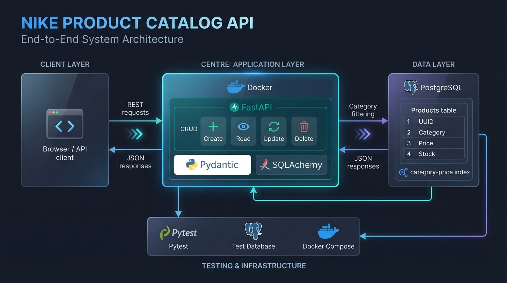

# Nike Product Catalog API

A REST API for managing an e-commerce product catalogue. Supports product creation, retrieval, updates, deletion, category and price filtering, and pagination.

## Technology Stack

- Python 3.13 and FastAPI
- PostgreSQL 16
- SQLAlchemy and Pydantic
- Docker and Docker Compose
- Pytest

## Getting Started

### Prerequisites
- Docker Desktop
- Git

No local Python or PostgreSQL installation is required.

### Run the application

```bash
git clone https://github.com/7skaliahmed07/nike-product-catalog-api.git

cd nike-product-catalog-api

docker compose up --build -d
```

Docker Compose starts PostgreSQL and the FastAPI application.

Once running, access:

- API: http://localhost:8000
- Swagger documentation: http://localhost:8000/docs


## System Architecture




## API Endpoints

| Method | Endpoint | Description |
|---|---|---|
| POST | `/products` | Create a product |
| GET | `/products` | List and filter products |
| GET | `/products/{product_id}` | Retrieve a product |
| PUT | `/products/{product_id}` | Replace a product |
| PATCH | `/products/{product_id}` | Partially update a product |
| DELETE | `/products/{product_id}` | Delete a product |

### Create a product

```json
{
  "name": "Nike Air Max",
  "description": "Running shoes",
  "category": "Shoes",
  "price": 120.00,
  "stock": 50
}
```

### Filter and paginate products

```http
GET /products?category=Shoes&min_price=50&max_price=150&page=1&limit=20
```

Supported filters:
- `category`
- `min_price`
- `max_price`
- `page`
- `limit` (maximum 100)

### Partial update

```json
{
  "price": 150.00,
  "stock": 25
}
```

PATCH updates only the supplied fields. Empty update requests are rejected.

## Database Design

The `products` table contains:

| Column | Type |
|---|---|
| id | UUID (Primary Key) |
| name | VARCHAR(255) |
| description | TEXT |
| category | VARCHAR(100) |
| price | NUMERIC(10,2) |
| stock | INTEGER |
| created_at | TIMESTAMPTZ |
| updated_at | TIMESTAMPTZ |

A composite index on `(category, price)` supports common category and price filtering queries.

PostgreSQL was selected for structured product data, filtering, transactions, and indexing.

## Testing

Run automated tests using the separate PostgreSQL test database:

```bash
docker compose run --rm app python -m pytest -v
```

The test suite covers:
- Product CRUD operations
- Partial updates and empty PATCH requests
- Category and price filtering
- Pagination
- Input validation and error handling

## Design Considerations

- Pagination limits response size.
- Database indexing supports common catalogue queries.
- UUIDs provide unique product identifiers.
- SQLAlchemy connection pooling manages database connections.

Potential future improvements include cursor-based pagination, caching, database migrations, and load testing with a larger dataset.

## Author

**Uzer Ahmed**

GitHub: https://github.com/7skaliahmed07